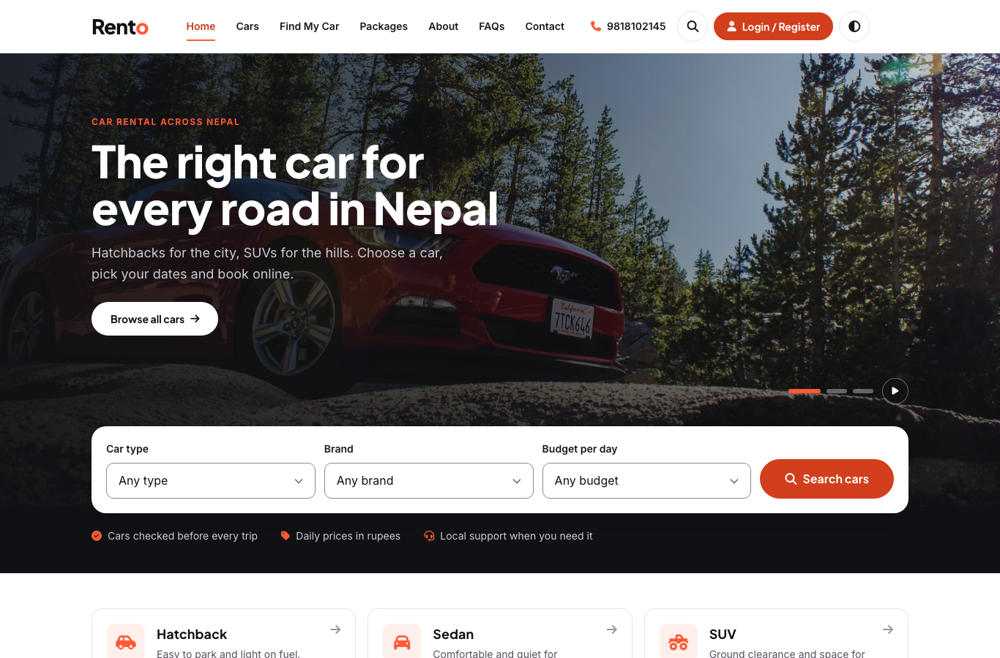
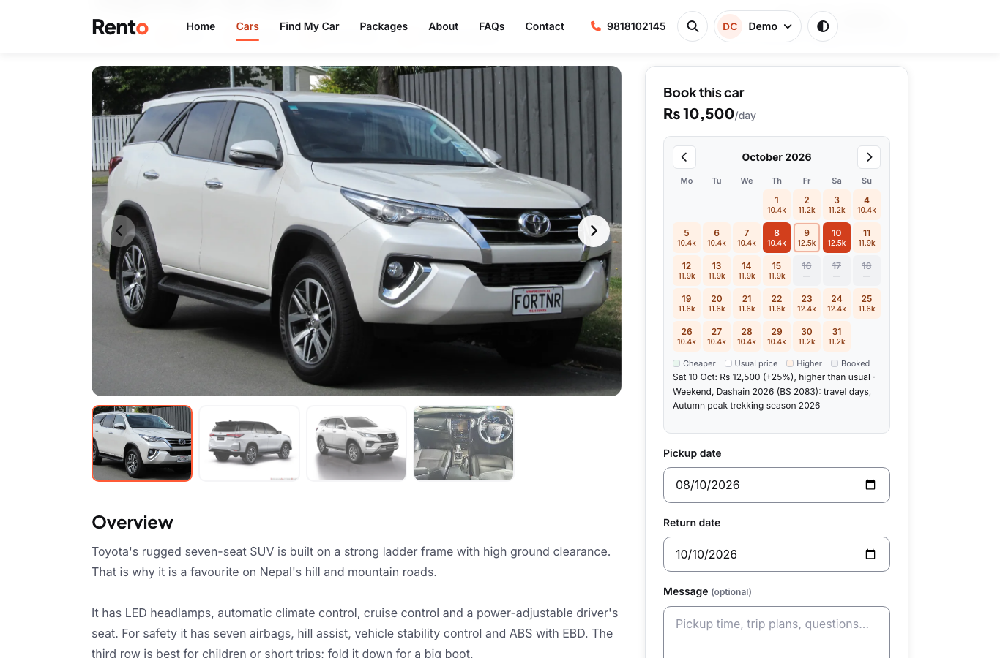
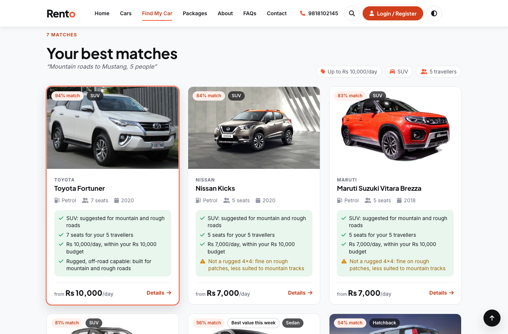
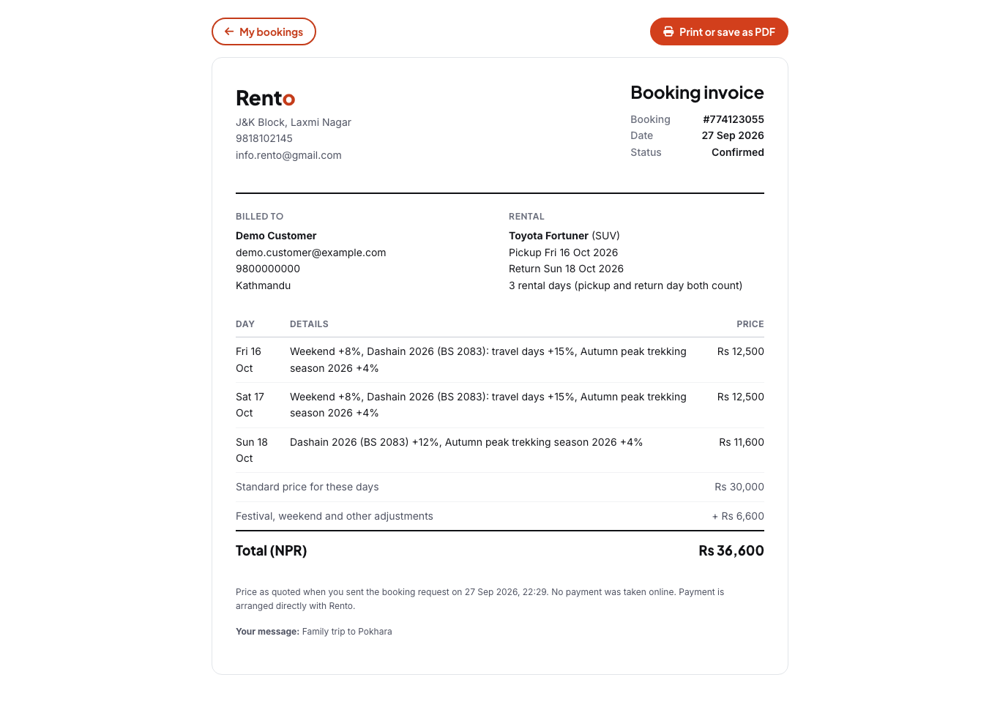
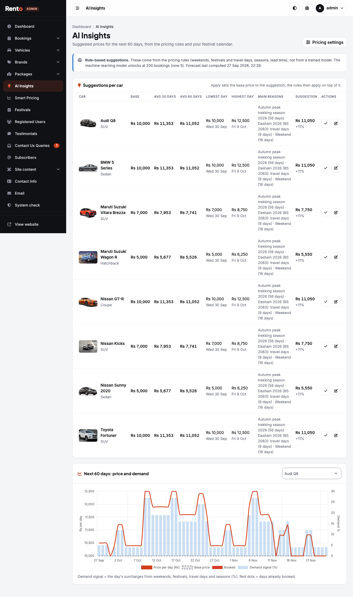
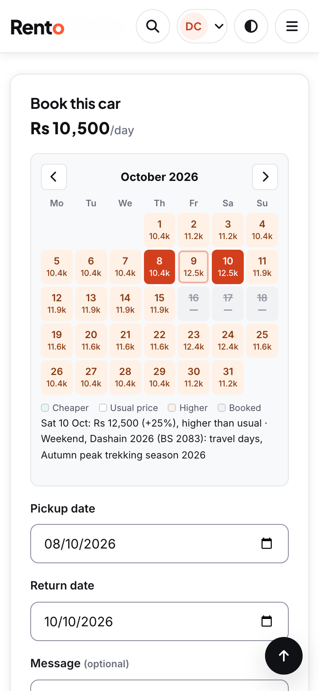

# Rento

Car rental website for Nepal: self-drive cars, cars with a driver, and packages (tours, airport transfers,
hourly hire). Customers browse the fleet, see a price for every day, get car suggestions for their trip,
and send booking requests. The admin confirms bookings, manages cars, packages, content and pricing.

- **PHP 8.3 + MySQL 8** (PDO, prepared statements), Apache with `.htaccess` clean URLs.
- **Bootstrap 5.3, Font Awesome 6, DataTables 2, Chart.js 4, Quill 2**, served from `assets/vendor/`
  (no build step).
- **Python 3.12** for the smart-pricing forecast (`ml/`). **PHPMailer** (Composer) for optional SMTP email.

Repository: **[INSERT GitHub link]** (branch `main`; work happens on `dev` and `feature/*`).

## Screenshots

| | |
|---|---|
|  |  |
| Home page | Car page: colour-coded price calendar with day prices and reasons |
|  |  |
| Find My Car results with match % and reasons | Printable invoice at the stored price |
|  |  |
| Admin AI Insights | Mobile (390 px) |

All screenshots: `docs/report/screenshots/` (desktop, mobile, dark mode, admin).

## Run it locally (MAMP)

1. Put the folder at `/Applications/MAMP/htdocs/Rento` and start MAMP: Apache on 8888, MySQL on 8889.
2. **Database `rento`:** import a dump of the current database. Schema changes since the original are in
   `database/migrations/` (001–022, additive only), applied in order with an admin MySQL account.
3. **Secrets** live in `includes/config.local.php`, which is git-ignored:

   ```php
   <?php return ['DB_USER' => 'rento', 'DB_PASS' => '…', 'APP_KEY' => '…'];
   ```

   Environment variables `RENTO_DB_*`, `RENTO_DEV_MODE` and `RENTO_APP_KEY` override it. Without either,
   dev mode falls back to MAMP's defaults. The app user needs only SELECT, INSERT, UPDATE and DELETE.
4. **Libraries:**
   - `composer install --no-dev` (PHPMailer)
   - `python3.12 -m venv ml/.venv && ml/.venv/bin/pip install -r ml/requirements.txt`
5. **Prices:** run `php tools/run-forecast.php "first run"`. They also recompute nightly (launchd:
   `tools/com.rento.price-forecast.plist`) and after changes.
6. **Open** `http://localhost:8888/Rento/`, and the admin at `http://localhost:8888/Rento/admin/`.

Moving to real hosting: **[docs/deployment.md](docs/deployment.md)**, then run
`php tools/check-production.php https://your-site/`.

## Project structure

```
index.php, car-listing.php, vehical-details.php (car/<name>-<id>), car-recommendation.php (Find My Car),
packages.php, package-details.php (package/<name>-<id>), my-booking.php, invoice.php, profile.php, …
                        public pages (clean URLs: /about-us serves about-us.php, see .htaccess)
sitemap.php, robots.php   /sitemap.xml and /robots.txt
api/                      JSON API (GET): price-quote, price-calendar, recommend
admin/                    admin area (own session); admin/includes/layout.php = shell, menu, helpers
includes/                 shared PHP (blocked from the web):
  config.php                settings + DB connection; config.local.php = secrets (not in git)
  security.php              sessions, CSRF, password hashing, HTML cleaning
  pricing.php               smart-pricing reads (quotes, forecast status), booking totals
  price-insights.php        card "from" prices, badges, price suggestions
  recommendation_engine.php, trip-parser.php   Find My Car scoring
  festivals.php, packages.php, enquiry-form.php, mailer.php, seo.php, site-content.php, settings.php
  production-check.php      checks behind tools/check-production.php and admin -> System check
assets/css/tokens.css     design tokens: colours (light + dark), type, spacing, focus rings
assets/css/app.css        public site styles (r- prefix);  admin/css/admin.css (a- prefix)
assets/js/                interface.js, theme.js (dark mode), price-calendar.js, rento-ai.js
ml/                       Python: pricing_rules.py, batch_forecast.py, tests; venv in ml/.venv
database/migrations/      NNN_*.sql, additive schema and data changes; database/undo/ = undo scripts
tools/                    command-line scripts: run-forecast, check-production, generate-webp, make-share-image
tests/                    PHPUnit (Unit, Integration), pytest (python/), evaluation scripts (evaluation/)
docs/                     guides and research (docs/README.md); docs/report/ = FYP figures, diagrams,
                          screenshots, results
logs/                     forecast.log, mail.log (blocked from the web)
```

## How smart pricing works

- **Usual price:** each car has one, `PricePerDay`, set in admin.
- **Forecast:** a rule-based forecast (`ml/pricing_rules.py`, run by `ml/batch_forecast.py`) works out the
  price of every active car for each of the next **60 days** and stores it in `tbl_price_forecast`,
  with the reasons.
- **Factors** (sizes are admin settings, see `includes/settings.php` → admin → Smart Pricing):
  - weekend days (Friday, Saturday)
  - festivals by demand level, and their travel days before
  - travel seasons
  - last-minute and early booking
  - occupancy and recent demand (these two only after 50 confirmed bookings)
- **Limits and rounding:** the total adjustment is capped (−15% / +25%), prices are rounded to Rs 50,
  and manual overrides from admin → AI Insights replace the rule price for their dates.
- **When it runs:** the recompute runs in the background. PHP starts it after bookings and admin changes
  (`forecast_request_recompute()`), and launchd or cron runs it nightly. Python gets the DB settings from
  environment variables, never command-line arguments.
- **Pages only read the forecast** (`includes/pricing.php`): the car page calendar, the booking quote, the
  cards' "from" price (lowest in 30 days) and the admin charts. Beyond the forecast, the usual price is used.
- **Quote at booking:** the price is re-computed on the server (never taken from the browser) and stored
  with the booking (`quoted_price`, `pricing_details` per day). That stored total is the price on
  "My bookings", the invoice, emails and admin revenue.
- **Machine-learning model:** a gradient-boosting demand model (`ml/pricing_model.py`) stays locked until
  there are 200 real bookings. admin → Smart Pricing → Model health shows the status.

## How recommendations work (Find My Car)

- **Reading the trip:** `includes/trip-parser.php` (and the same rules in `assets/js/rento-ai.js`) reads a
  plain-language trip, such as "family trip to Pokhara under Rs 8,000", "mountain roads to Mustang, 5 people".
  It picks out the car type (named or inferred), budget, travellers, fuel, the kind of road (city /
  highway / mountain) and context (family, luggage, business).
- **Scoring:** `CarRecommendationEngine` (`includes/recommendation_engine.php`) scores every active car on
  the criteria that apply:
  - type: 30 if named, 15 if inferred
  - seats: 15
  - budget: 20, against the price on the chosen dates or the card's "from" price
  - road: 15, or 25 on mountain and rough-road trips, where only cars flagged **Rugged / off-road**
    score full marks
  - comfort and luggage: 10
  - fuel: 10
  - the customer's rental history: 10
  - model year: 5
- **Match %** is the share of the applicable weights earned. Cars that can't work (too few seats, booked,
  more than 10% over budget) are left out. Matches under 40% are hidden. Sports cars get cautions for
  family, luggage and rough-road trips.
- **Reasons:** every reason and caution shown comes from the score. An inferred type says so ("Sedan:
  suggested for highway trips") instead of "the Sedan you asked for".
- **Read-only:** nothing is written to the database.

## Database schema

MySQL 8, database `rento`, **23 tables**. Schema changes since the original template are in
`database/migrations/` (001–022, additive). There are **no foreign-key constraints**: the relationships are
logical and are enforced in PHP. Full column list: `docs/report/diagrams/schema.json`. ERDs:
`docs/report/figures/diagrams/erd_core.png` and `erd_support.png`.

| Table | Columns | Purpose |
|---|---|---|
| `admin` | 5 | Admin accounts (bcrypt passwords, optional email for reset links) |
| `tbl_forecast_runs` | 9 | Queued / finished price recompute runs, with status and message |
| `tbl_price_forecast` | 9 | Price of every active car for each of the next 60 days, with multiplier and reasons |
| `tbl_price_overrides` | 8 | Manual prices for date ranges (AI Insights) |
| `tblbooking` | 13 | Booking requests, with the stored quoted price and per-day details |
| `tblbrands` | 5 | Car brands and logos |
| `tblcontactusinfo` | 4 | Business address, email and phone |
| `tblcontactusquery` | 7 | Messages from the contact form |
| `tblfestivals` | 13 | Festival calendar: dates, demand level, travel-day window, verification, source |
| `tblmailsettings` | 3 | SMTP settings (password encrypted) |
| `tblpackagecategories` | 7 | Package categories |
| `tblpackageenquiries` | 16 | Package and with-driver requests, status and admin notes |
| `tblpackageimages` | 4 | Package gallery photos |
| `tblpackages` | 21 | Tours and services: prices per vehicle type, itinerary, inclusions |
| `tblpages` | 7 | About, FAQs, Terms, Privacy (live text and draft) |
| `tblpasswordresets` | 7 | Single-use reset tokens (SHA-256 hash, expiry) for customers and admins |
| `tblratelimits` | 5 | Attempts per action, IP and email for rate limiting |
| `tblsettings` | 3 | Changed smart-pricing settings (defaults in includes/settings.php) |
| `tblsitecontent` | 3 | Editable site texts and images |
| `tblsubscribers` | 3 | Newsletter sign-ups |
| `tbltestimonial` | 5 | Customer testimonials (shown after approval) |
| `tblusers` | 11 | Customer accounts (bcrypt passwords) |
| `tblvehicles` | 32 | Fleet: price, type, seats, fuel, active / driver-only / rugged flags, photos, features |

Logical relationships:
- `tblvehicles.VehiclesBrand` → `tblbrands.id` (brand of)
- `tblbooking.VehicleId` → `tblvehicles.id` (books)
- `tblbooking.userEmail` → `tblusers.EmailId` (made by)
- `tbl_price_forecast.VehicleId` → `tblvehicles.id` (prices)
- `tbl_price_forecast.RunId` → `tbl_forecast_runs.id` (written by)
- `tbl_price_overrides.VehicleId` → `tblvehicles.id` (overrides)
- `tbltestimonial.UserEmail` → `tblusers.EmailId` (written by)
- `tblpasswordresets.UserId` → `tblusers.id` (resets (AccountType=user))
- `tblpasswordresets.UserId` → `admin.id` (resets (AccountType=admin))
- `tblpackages.CategoryId` → `tblpackagecategories.id` (in category)
- `tblpackageimages.PackageId` → `tblpackages.id` (photo of)
- `tblpackageenquiries.PackageId` → `tblpackages.id` (about package)
- `tblpackageenquiries.VehicleId` → `tblvehicles.id` (about driver-only car)

## Machine learning: evaluation (offline)

The live site prices with the **rule-based** pricer, because Rento has only 4 real bookings (2 confirmed).
The gradient-boosting model stays switched off until 200 bookings. `ml/train_evaluate.py` shows how learned
models would perform once there is data. It uses **external data, not Rento bookings**. Details and charts:
`docs/report/results/ml_results.md`.

| Experiment | Data | Best model | MAE | RMSE | R² |
|---|---|---|---|---|---|
| 1 Hourly demand | 18,247 hourly rows (public dataset), chronological split | Gradient Boosting | 30.5 | 38.1 | 0.285 |
| 1b Daily demand | 654 days, chronological split | Random Forest | 251 | 327 | 0.489 |
| 2 Day price | 1,640 scraped Sajilo listings, the MLP's held-out split | Random Forest | Rs 101 | Rs 251 | 0.981 |

The comparison includes Linear Regression, Random Forest, Gradient Boosting, the existing PyTorch MLP (Experiment 2)
and baselines. There is also time-series cross-validation (demand) and GroupKFold on unseen vehicle models (price).

Rule-based pricer, checked on the live forecast: 480 rows, 0 outside the −15%/+25% caps,
0 not rounded to Rs 50; 48 days where the factors add up to more than the cap are capped.
Recommendations (12 test trips through `api/recommend.php`): normalised precision@3 0.94,
hit@1 0.91, rule checks 12/12.

## Tests

```sh
composer install                                   # includes PHPUnit (dev)
/Applications/MAMP/bin/php/php8.3.14/bin/php vendor/bin/phpunit   # Unit + Integration (MAMP must be running)
ml/.venv/bin/pip install -r ml/requirements-dev.txt
ml/.venv/bin/python -m pytest -q tests/python ml/test_pricing_rules.py
ml/.venv/bin/python ml/train_evaluate.py           # ML experiments -> docs/report/
ml/.venv/bin/python tests/evaluation/evaluate_recommendations.py
ml/.venv/bin/python tests/evaluation/evaluate_pricing.py
ml/.venv/bin/python tests/evaluation/measure_performance.py
```

Results (27 Sep 2026): PHPUnit **54 tests, 268 assertions, 0 failures** (30 unit, 24 integration); pytest **46 passed**.
Integration tests create a temporary customer account with a random password and delete it afterwards.

## Conventions

- **URLs, file names and form field names stay the same.** New pages get new files.
- **Database changes are additive** (`database/migrations/`); back up before each migration.
- **No secrets in git.** Credentials come from `config.local.php` or environment variables.
- **Admin actions** are POST with CSRF and a confirmation for destructive ones.
- **Accessibility:** WCAG 2.1 AA in light and dark themes, full keyboard use, and `prefers-reduced-motion`
  respected.
- **Decisions** made on the owner's behalf are recorded in [docs/decisions.md](docs/decisions.md).

## Documentation

See **[docs/README.md](docs/README.md)**: the admin guide, **deployment guide
([docs/deployment.md](docs/deployment.md))**, decisions, research, legal drafts and the FYP report material
(`docs/report/`).

## Origin and credits

Rento started from the open-source *Car Rental Portal* PHP template (the baseline commit). Almost all of it has
since been rewritten: the security work, redesign, admin, pricing engine, forecast, recommendation engine,
APIs, tests and docs. Development used Claude (Anthropic) as a coding and documentation assistant; the
author directed, reviewed and tested the work (see the `Co-Authored-By` lines in the git history).
